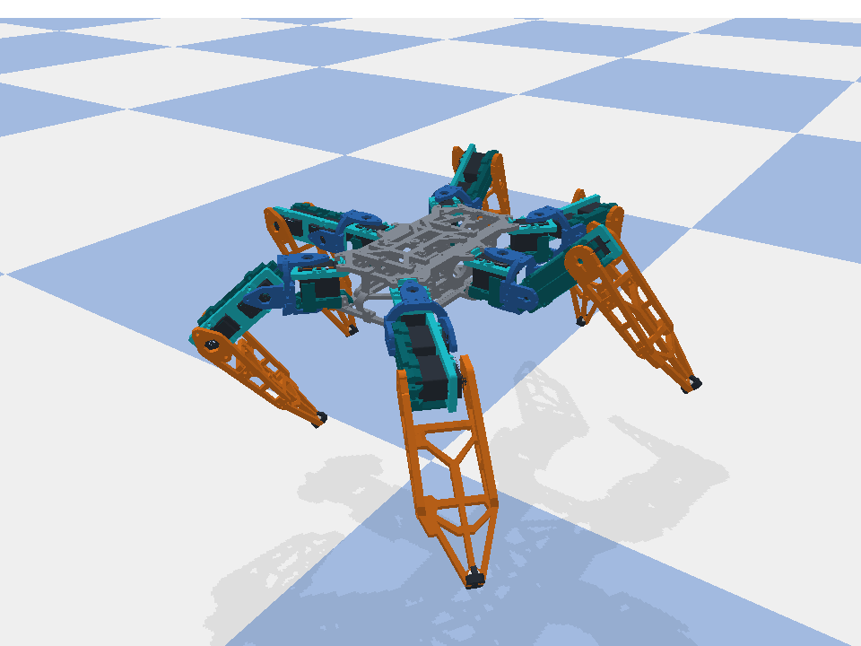
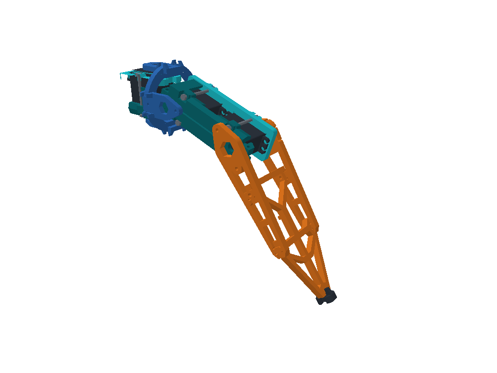

# Whole Spyder simulation

`Spyder parts/main.stl` is now a complete PyBullet robot: **a body and six legs with 18 revolute servo joints**, each of which can be moved on its own. The single-leg model further down is unchanged.



See it [walking](previews/spyder_walk.gif) or in its [exported home pose](previews/spyder_home.png).

## Run it

PyBullet is currently installed only in WSL on this computer, and the WSL commands below were the ones tested. From the `Simulation` folder in a WSL terminal, with `python3` being an interpreter that has `requirements.txt` installed:

```bash
python3 simulate_spyder.py
```

| Command | What it does |
|---|---|
| `python3 simulate_spyder.py` | A slider for every joint, plus body position and rotation. Body held in the air, no gravity. |
| `python3 simulate_spyder.py --physics` | The same joint sliders on a free robot standing on the ground under gravity. It can fall over. |
| `python3 simulate_spyder.py --walk` | Tripod gait, with sliders for speed and turn rate. `--speed 60 --turn 10` sets the starting values (mm/s, deg/s). |
| `python3 simulate_spyder.py --demo` | Moves each of the 18 joints in turn. |

Add `--direct --seconds 5` to any of them to run without a window, `--screenshot previews/my_pose.png` to save an image, and `--set fr_femur_pitch=-30` (repeatable) to start a joint at an angle in degrees. Every run first prints the joint list with limits. A red message in the window warns when neighbouring legs overlap.

## Joints

Each joint is named `<leg>_<joint>`, for example `ml_tibia_pitch`.

| Leg prefix | Position | Heading |
|---|---|---|
| `fr` / `mr` / `rr` | front / middle / rear right | 45° / 0° / −45° |
| `fl` / `ml` / `rl` | front / middle / rear left | 135° / 180° / −135° |

| Joint | Motion | Axis | Range | Stops at the limit because |
|---|---|---|---|---|
| `coxa_yaw` | Swings the leg sideways; positive turns it anticlockwise from above | Leg Z | ±55° | A joint plate reaches the yaw servo at about 60° |
| `femur_pitch` | Positive lowers the foot, negative raises it | Leg Y | ±80° | A leg cover reaches the coupling at about 85° |
| `tibia_pitch` | Positive swings the foot in, negative out; −90° is about straight along the femur | Leg Y | −90° to +50° | The foot reaches a leg cover at about 55° (the −90° end is a chosen stop) |

**All angles are zero in the pose exported in `main.stl`:** femurs level, tibias vertical. Axes run through the measured servo output splines. `spyder.json` assumes **+Y is the front** and +X the robot's right, because the STL does not say which end is the front; changing that only renames legs and the walking direction.

Lengths measured from the CAD: yaw axis to hip axis **43.96 mm**, hip to knee **75.96 mm** (the knee sits 0.41 mm higher), knee to foot **161.17 mm**, foot offset sideways **3.36 mm**. The body-frame origin is the robot's centre at CAD Z = 0, and the feet are 131.0 mm below it at home.

## Move it from Python

```python
import math
import pybullet as p
import simulate_spyder as sim

ground = sim.connect(direct=False, gravity=True)
robot = sim.Spyder(ground=ground)
robot.print_joints()

targets = {name: 0.0 for name in robot.joints}
targets["fr_femur_pitch"] = math.radians(-30)        # One joint, radians
targets.update(robot.foot_targets("ml", [-0.20, 0.0, -0.10]))  # One foot, body-frame metres (IK)

while p.isConnected():
    robot.command(targets)     # Checked against the limits. Keep this inside the loop.
    p.stepSimulation()
```

`robot.pose(targets)` sets angles directly without motors. `TripodGait(robot).targets(time_s, forward, turn)` gives walking targets. `kinematics.SpyderLeg` has `forward(angles)`, and `inverse(position)` is the closed-form method from the course notes (yaw from `atan2`, then a two-link triangle from the hip), corrected for the CAD's sideways foot offset and raised knee.

## How the model is made

`main.stl` keeps each CAD body as a separate closed shell: 570 in total, including 18 servos and their screws and lettering. `build_spyder.py` finds each part by its bounding box in a leg frame, using the table in `spyder.json`, and assigns it to a link:

| Link | Parts | Moves with |
|---|---|---|
| `body` | The six frame shells | Free base |
| `<leg>_base` | Yaw servo, `thigh_bottom`, `thigh_top` | Fixed to the body |
| `<leg>_coxa` | Coupling ring and its four plates | `coxa_yaw` |
| `<leg>_femur` | Hip and knee servos, `leg_bottom`, `leg_top` | `femur_pitch` |
| `<leg>_tibia` | The four foot pieces | `tibia_pitch` |
| `<leg>_foot_tip` | 6 mm contact sphere, no visible part | Fixed to the tibia |

The six legs in `main.stl` match to within 0.0001 mm once rotated, so they share one mesh set in `meshes/spyder/`. Each link collides as a single convex hull, and only the foot spheres touch the ground. Measured properties are in `spyder_report.json`. After changing `main.stl` or `spyder.json`:

```bash
python3 build_spyder.py
python3 -m unittest discover -s tests
python3 render_spyder.py
```

A re-export with the same geometry rebuilds as it is. If a part moved or changed size, the builder stops and names the part it could not find, and its bounding box in `spyder.json` needs updating.

## What has been checked

`tests/test_spyder.py` covers these, and all pass:

- The joint list has exactly 18 revolute joints, and each moves only the links beyond it.
- Every `main.stl` triangle is used once, and the rebuilt robot at zero angles matches the STL to within 0.01 mm.
- Forward kinematics matches PyBullet on every leg, and inverse kinematics round-trips to 1e-9 m over random poses.
- Invalid angles and unreachable foot targets are rejected.
- It stands with its weight shared across six feet (about 2.7 N each) without drifting.
- The tripod gait walks and turns in the commanded direction, stays upright, and neighbouring legs do not overlap.

| Simulated run (6 s, including a 1.2 s start-up) | Result | Peak servo torque |
|---|---|---|
| Walk at 40 mm/s | 205 mm forward, tilt 0.2° | 0.65 N m |
| Walk at 80 mm/s | 415 mm forward, tilt 0.3° | 0.79 N m |
| Turn at 17 deg/s | 88° with almost no drift | 0.62 N m |

## Limits of this model

- **The cradles still overlap the coupling.** `main.stl` has the same interference described for the single leg: the bottom plates and ring sit inside `thigh_bottom` and `leg_bottom` by up to about 1.6 mm, already 1.2 mm in the home pose, and the joint limits above ignore it. The simulation moves through it, but the printed parts would not. The cradle reliefs have not been cut.
- **Physics results are estimates, not a hardware test.** Mass is 1.63 kg, from 55 g per servo plus printed parts at an assumed 700 kg/m³. The **battery and controller are not in the CAD**, so real torque will be higher; set `electronics_kg` in `spyder.json` once they are known. Torque is capped at an assumed 0.9 N m and speed at 5.2 rad/s, nominal MG996R figures for a servo that is still unconfirmed, and `SERVO_STIFFNESS` in `simulate_spyder.py` is illustrative. The walking peaks are already close to that cap.
- **Self-collision is only a warning.** Parts pass through each other in the simulation. The red message covers neighbouring legs, using convex hulls that are larger than the real parts; they first overlap with both neighbours turned about 40° towards each other, and never with one leg moving alone. Other overlaps, such as a leg against the body, are not reported.
- Cables, screws beyond those in the CAD, servo backlash and horn centring are not modelled. The ±90° physical range of each servo depends on how its horn is fitted.

`simulate_main.py` is the earlier viewer that treats `main.stl` as one rigid body. It still works but has no joints.

---

# Assembled 3-DOF robot leg

Your **14 original STL files have been fitted into 16 imported parts and three movable joints**, following the supplied **Foot Design, Leg design 3 and Thigh Design** assembly references. Leg Designs 1 and 2 are excluded. The combined `Thigh Design.stl` was separated into its servo and two brackets. Six simplified long fasteners are modelled separately. The four foot pieces form one rigid moving link. Original STLs are unchanged, except that the upper frame inside `Thigh Design.stl` was updated from the revised Fusion `thigh_top` (see Corrections).

This is a **geometry-derived, provisional assembly for kinematics**. The exports have inconsistent scales and do not include CAD constraints, bearings, horns or fasteners. The fitting corrections and remaining gaps are documented below and in `assembly.json`; this is not a verified manufacturing assembly.



[Compare the three individual assemblies with the CAD references](previews/reference_components.png).

## Run it

For a fresh GitHub clone, run these commands from the repository root in PowerShell:

```powershell
cd Simulation
python -m venv .venv
.\.venv\Scripts\python.exe -m pip install -r requirements.txt
```

The virtual environment is local to your machine and is not included in Git. If you are using the already prepared working copy, skip this setup step.

To start writing your own Python simulation, open **`my_simulation.py`** and run:

```powershell
.\.venv\Scripts\python.exe my_simulation.py
```

This editable starter loads `leg_assembled.urdf`, enables gravity, holds the base fixed, and uses motor position control. It moves the knee gently while holding the other two joints. Edit **`get_target_angles(simulation_time)`** to change the movement; angles are in radians. For example, replace the sine-wave line with `targets["tibia_pitch"] = 0.35` to hold that angle. Every command is checked against the model's joint limits.

The motor commands belong inside the simulation loop: code placed after `while p.isConnected()` does not run until the window closes. The script finds joints by name because index 0 is a fixed mesh attachment in this model. `useFixedBase=True` represents the leg mounted to a chassis; setting it to `False` would release the entire leg under gravity. Physical properties and torque limits remain approximate.

For a quick test without opening a window:

```powershell
.\.venv\Scripts\python.exe my_simulation.py --direct --seconds 2
```

The existing `simulate.py` remains the slider/IK viewer described below.

After setup (or in the already prepared working copy), run the viewer from this folder's PowerShell terminal:

```powershell
.\.venv\Scripts\python.exe simulate.py
```

Move the **coxa_yaw**, **femur_pitch**, and **tibia_pitch** sliders. Close the window to exit. Default mode poses the joints without gravity.

Bright cyan identifies the upper plates; dark teal identifies the lower cradles, blue the joint coupling, orange the foot, and black the servos. Grey long fasteners follow the reference layout; their diameters and simplified unthreaded geometry are provisional because no screw STL was supplied.

```powershell
# Animate all three joints
.\.venv\Scripts\python.exe simulate.py --demo

# A specific pose: degrees, yaw / hip / knee
.\.venv\Scripts\python.exe simulate.py --angles 12 -10 40

# Inverse kinematics: foot position in metres relative to base_link
.\.venv\Scripts\python.exe simulate.py --target 0.25683695 0.058523035 -0.070169038

# Headless verification or a screenshot
.\.venv\Scripts\python.exe simulate.py --direct
.\.venv\Scripts\python.exe simulate.py --screenshot previews/my_pose.png

# Optional approximate dynamics with a fixed base
.\.venv\Scripts\python.exe simulate.py --physics

# Original illustrative box model
.\.venv\Scripts\python.exe simulate.py --primitive
```

`--mesh` is an alias for the default assembled model. `--steps 480` changes headless run length. `--base-height 0.28` sets mounting height above the ground. `launch.ps1` is an optional shortcut for the local interpreter.

See the [motion animation](previews/joint_motion.gif), [neutral view](previews/neutral.png), and [joint detail](previews/joint_detail.png).

Rebuilding the fitted meshes additionally requires `requirements-build.txt`. PyBullet must be installed for the chosen interpreter; a source build may be required if no compatible binary package is available. The existing local development environment reuses an installed copy of PyBullet; fresh clones install their own dependencies.

## Assembly structure

| Rigid group | Supplied parts | Motion |
|---|---|---|
| `base_link` | Servo, lower bracket and upper frame from `Thigh Design.stl` | Fixed mount |
| `coxa_link` | Joint ring and all four joint plates | Yaw about Z |
| `femur_link` | Both leg shells and both leg servos | Hip pitch about Y |
| `tibia_link` | All four foot pieces | Knee pitch about Y |
| `foot_tip` frame | Massless endpoint at the outer pad centre | Used for FK/IK |

The joint ring couples the perpendicular thigh and hip servo axes. The proximal leg servo sits in the moving housing, with its shaft attached to the coxa bracket. The distal servo casing stays with that housing and drives the foot. Therefore the proximal servo casing moves when the hip pitches; this is intentional.

The duplicate joint exports are byte-identical files, used as separately positioned instances. The motor exports are also identical geometry.

Both servo-holder assemblies span the motor bodies: their lower cradles support the backs of the servos, while the upper plates sit above their mounting flanges near the output shafts. The aligned mounting holes are connected by long fasteners, with 22 mm between the leg's post tops and upper plate and 24 mm in the thigh. Those spans are intentional in the supplied assembly references.

Each visual part has its own fixed attachment in the URDF so PyBullet's GUI preserves its colour. These fixed attachments add no degrees of freedom. Locate movable joints by name, not numeric index.

| Fitted measurement | Value |
|---|---:|
| Yaw axis to hip axis | 43.4112 mm |
| Hip axis to knee axis | 76.5762 mm |
| Knee axis to end-pad centre along foot X | 166.9327 mm |
| End-pad lateral offset from knee frame | 3.3552 mm |
| Foot sideplate inside gap | 45.9105 mm |

At zero angles the leg extends along +X, with Z upward. Positive yaw turns toward +Y; positive pitch bends toward −Z. The coxa frame sits 2.6 mm above the thigh's neutral Z plane and the leg link is offset −3.6 mm in Y, because the servos stay seated on the reshaped coupling ring. The endpoint's lateral offset is included in the kinematics.

## Corrections and fit limits

These are physical fitting corrections **before** millimetres are converted to metres:

| Parts | Correction and evidence |
|---|---|
| All five joint files | Scale 0.1: resulting 5.933 mm ring thickness fits roughly 6.2 mm fork slots; ring recesses match plate thickness. |
| Both joint top plates | Additional X factor 0.974359 makes opposing shaft holes coaxial. |
| Coupling ring | The `compress_lobes` setting in `assembly.json` moves the recess floors in to 24.2 mm facing the yaw plates and 23.2 mm facing the pitch plates, leaving recess widths and ring thickness unchanged. Both bottom plates then sit 0.2 mm from their cradles. A plain scale cannot do this because it narrows the recesses, and the thigh stack (48.2 mm) is 2 mm taller than the leg stack (46.2 mm). |
| All four joint plates | Each `joint_top` (hex bore) sits on its servo's output side, on the output shoulder beside `thigh_top`/`leg_top`. Each `joint_bottom` (round pivot bore) sits on the back side beside `thigh_bottom`/`leg_bottom`. All fork tabs face their servo and straddle the ring's recess band. |
| Leg upper cover | X factor about 0.990107, Y about 1.000400, aligned using four screw-hole centres. |
| Thigh upper cover | Y factor 0.999001 aligns the 28.028 mm source hole pitch with the lower cradle's 28 mm pitch. |
| Thigh upper cover relief | Two cuts were made in Fusion `thigh_top` (mesh cut, then stitched) so the yaw coupling can turn. The raised front bar is cut back to a 15.8 mm radius from the yaw axis, and the frame's front edge is trimmed to a 23.25 mm radius. Material elsewhere is unchanged within 0.005 mm. Only these triangles changed in `Thigh Design.stl`; servo and cradle triangles are byte-identical. |
| Foot ground brace | X factor 0.990517 aligns both crossbars with the sideplate fittings. Other axes retain native size. |
| Servos and remaining pieces | Original size retained; translated and rotated. |

The servo is provisionally treated as MG996R-size following your description; its identity is **not confirmed**. TowerPro lists a nominal 40.7 × 19.7 × 42.9 mm body for the [MG996R](https://torqpro.com/product/mg996r/). The supplied servo mesh, including ears and spline, remains the fitting reference.

Remaining uncertainties:

- Foot shaft centres differ by **0.1328 mm** in X when distal fittings align.
- Leg shell openings and servo casing centres differ by roughly **1 mm**.
- The original short-clamp interpretation is superseded by the assembled CAD references. Plates now sit on opposite ends of each servo body. The added rear adapter and short spacers have been removed.
- Six simplified long fasteners use the measured mounting-hole axes. Their 3 mm shanks and hex ends are illustrative; threads and final hardware specifications are not modelled.
- The complete foot is offset axially to leave **0.2 mm nominal clearance** behind the corrected leg cradle. Its four pieces retain their relative positions.
- The back-side coupling plates sit **0.2 mm** from both the thigh cradle and the leg cradle. **The cradles are not relieved yet:** across the joint ranges, the bottom fork tabs and ring intersect `thigh_bottom` by up to 1.6 mm and `leg_bottom` by up to 1.35 mm. Each cradle needs a pocket about 5 mm deep in its back face, from 16.3 mm radius outward around its joint axis, before this can be built. The supplied thumbnails do not show the assembled coupling or specify its bearing/fastener hardware, so this interface is still unresolved. It has not been filled with an invented adapter.
- With the `thigh_top` relief, neither the ring nor `yaw_top` overlaps the thigh frame anywhere across the ±60° yaw range. Before the relief, they overlapped it by up to 2.5 mm and 0.8 mm respectively. The relief keeps 0.5 mm clearance to the swept tabs and ring, and at least 1.3 mm of wall around the two front screw holes. The leg-side plates clear `leg_top`, `leg_bottom` and the servo across the full hip range. The front bar's original purpose is unknown; check that its removal does not matter for the physical part.
- Detailed servo spline geometry stays in each casing's visual mesh; separate rotating horns and fasteners are not modelled.
- Joint limits, masses, inertia, effort and collision boxes are illustrative. Default simulation and IK do **not** certify collision-free travel. `--physics` exercises an approximate model and does not validate loading or walking.

Resolve these details against the physical servo and intended hardware before using these transforms for manufacturing or treating physics results as predictions.

## Editing and rebuilding

- `assembly.json`: assembly source of truth: part sources, scales, rotations, translations, link assignments and joint parameters.
- `assembly.json` separates the six illustrative long fasteners under `generated_supports` from imported source parts. Their dimensions and colours can be adjusted independently.
- `build_assembly.py`: reproduces fitted meshes and URDF without changing source STLs.
- `leg_assembled.urdf`: articulated model loaded by default.
- `meshes/assembled/`: generated meshes already in **metres** in their link frames; URDF scale is `1 1 1`.
- `assembly_report.json`: source SHA-256 hashes, coverage, triangle counts and fitted bounds.
- `kinematics.py`: FK, Jacobian and bounded numerical IK derived from URDF frames.
- `analysis/foot/assembly_transforms.json` and `analysis/joints/assembly_transforms.json`: supporting measurements and mating-feature evidence.
- `analysis/reference_fit/thigh_reference_transforms.json`: thigh positions and measured mating planes based on the assembled reference. This supersedes the earlier `analysis/gap_review/` placement study.
- `analysis/reference_fit/foot_reference_review.json`: internal foot assembly checked against the supplied Foot Design reference.
- Original primitive and mesh-template URDFs are retained as references. The mesh template is not used by the assembled simulator.

After changing `assembly.json`:

```powershell
.\.venv\Scripts\python.exe build_assembly.py
.\.venv\Scripts\python.exe -m unittest discover -s tests -v
.\.venv\Scripts\python.exe render_preview.py
```

The development script `analysis/create_manifest.py` records the initial fitting study; rerunning it replaces edits to `assembly.json`. Normal updates should edit the JSON and run only the builder.

## Verification and Python use

The assembly and kinematics tests cover original STL coverage/hashes, complete nonoverlapping thigh extraction, shaft alignment, plates on opposite ends of the motor bodies, cradle support and long-fastener spans, foot clearance, units, joint structure, FK against PyBullet at neutral/limit/random poses, IK round trips and limits, unreachable/invalid input rejection, and Jacobian finite differences. Two additional starter-script tests verify motor tracking under gravity, joint-name lookup and invalid-command rejection. Headless animation and component rendering also completed. The thigh, Leg design 3 and foot were inspected separately in the orientation of the supplied reference thumbnails. These checks verify the configured model; they do not certify physical clearances or hardware fit.

```python
import numpy as np
from kinematics import LegKinematics

leg = LegKinematics("leg_assembled.urdf")
position = leg.forward(np.radians([12, -10, 40]))  # base-frame metres
solution = leg.inverse(position)                 # joint radians
```

IK checks returned position error and reports failure when it cannot find an accurate solution. Numerical search is not a formal reachability proof and does not check mesh collisions.
